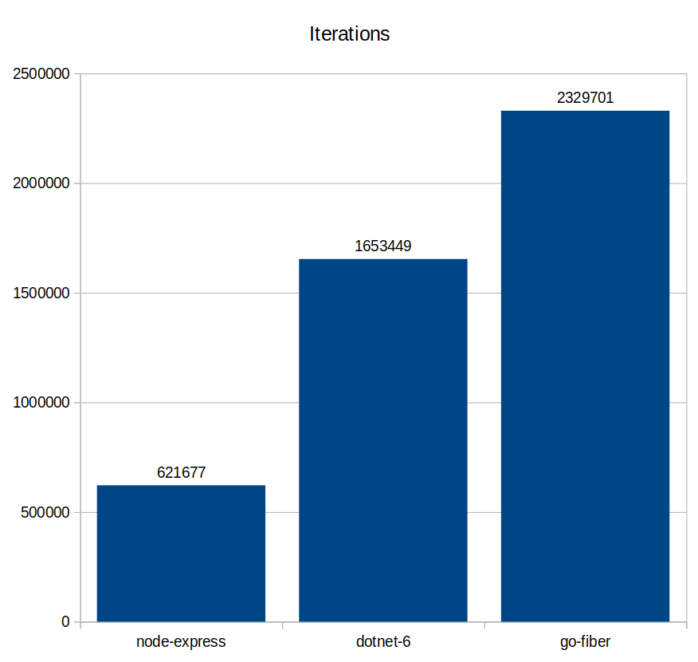

# ApiSmackdown

This repo is intended to allow comparison of the performance and simplicity (maintenance costs) of various API backend languages and frameworks.

Every server answers `GET /` with the same 25-byte `text/plain; charset=utf-8` body and the same minimal headers (`Content-Type`, `Content-Length`, `Date`), so the bytes on the wire are comparable. Two exceptions can't be switched off: Node always adds `Connection` and `Keep-Alive` headers on keep-alive connections (about 40 bytes), and Granian adds `server: granian` (about 16 bytes).

There are two groups of servers:

- **Idiomatic:** the normal way to write a small API in each language, with its most common framework. This is what the "simplicity and maintenance cost" comparison is about.
- **Tuned for speed:** what each language can do when speed is all that matters, by changing framework, build or runtime settings, or dropping the framework altogether. These are harder to maintain, and the hand-written epoll server isn't a real web server at all.

### Idiomatic

| Server | Folder | Port | Versions |
|---|---|---|---|
| Go, standard library `net/http` | `go-stdlib/` | 3000 | Go 1.27 |
| Node, Express | `node-express/` | 3001 | Node 26 LTS, Express 5 |
| .NET minimal API | `dotnet-10/` | 3002 | .NET 10 LTS |
| Python, FastAPI on Uvicorn | `python-fastapi/` | 3003 | Python 3.15, FastAPI 0.162, Uvicorn 0.54 |
| Rust, axum | `rust-axum/` | 3004 | Rust 1.99, axum 0.8, Tokio 1.54 |

### Tuned for speed

| Target | Folder | Port | What changes |
|---|---|---|---|
| `go-fasthttp` | `go-fasthttp/` | 3006 | fasthttp 1.76 instead of `net/http`: reuses request and response objects instead of allocating, but isn't compatible with the standard library |
| `node-fastify` | `node-fastify/` | 3007 | Fastify 5.12 instead of Express, one worker per core |
| `dotnet-tuned` | `dotnet-10-tuned/` | 3009 | Slim builder, no logging or routing, one bare handler, response bytes encoded once |
| `python-granian` | `python-granian/` | 3008 | Granian 2.8 (a Python server written in Rust) with a bare app on its RSGI interface, instead of FastAPI on Uvicorn |
| `rust-tuned` | `rust-axum/` | 3005 | The same axum code, built with link-time optimisation, one code-generation unit, for this exact CPU, with the mimalloc allocator |
| `rust-epoll` | `rust-epoll/` | 3010 | No framework or async runtime: one thread per core, each with its own socket and epoll loop, the response built once a second. Only answers GET; a demonstration of the ceiling |

The devcontainer installs Go, Node, the .NET SDK, Rust, uv (for Python), k6 and oha, so the setup below works out of the box there.

## Setups

### Go (standard library)

Since Go 1.22, `net/http` routes by method and path (`"GET /{$}"`), so no framework is needed and there are no dependencies.

```bash
cd go-stdlib
go build -o server . && ./server
```

The 2021 version used Fiber, which runs on fasthttp, not `net/http`. The Go numbers therefore aren't directly comparable with the 2021 results.

### Node (Express)

```bash
cd node-express
npm ci
npm start               # one process, one CPU core
npm run start:cluster   # one worker per CPU core (set WORKERS=n to change)
```

Node runs JavaScript on a single thread, while Go and .NET use every core. Benchmark both modes and say which one you report.

### .NET (10 minimal API)

Always benchmark a Release build without the Development launch profile:

```bash
cd dotnet-10
dotnet run -c Release --no-launch-profile
```

### Python (FastAPI on Uvicorn)

[uv](https://docs.astral.sh/uv/) installs Python 3.15 and the locked dependencies:

```bash
cd python-fastapi
uv sync
.venv/bin/uvicorn app:app --port 3003 --workers $(nproc) --no-access-log --no-server-header
```

Python, like Node, runs Python code on one core per process (the GIL), so Uvicorn runs one worker process per core. Set `WORKERS` to change that in the benchmark script.

### Rust (axum)

```bash
cd rust-axum
cargo build --release && ./target/release/rust-axum
```

Tokio, axum's runtime, uses every core by default.

### Tuned servers

`run-all.sh` builds and starts these with the right settings. By hand:

```bash
cd go-fasthttp && go build -o server . && ./server
cd node-fastify && npm ci && npm start
cd dotnet-10-tuned && dotnet run -c Release --no-launch-profile
cd python-granian && uv sync && .venv/bin/granian app:app --interface rsgi --port 3008 --workers $(nproc) --runtime-mode st --http 1 --no-ws --loop uvloop --no-access-log
cd rust-axum && RUSTFLAGS="-C target-cpu=native" cargo build --profile tuned --features mimalloc && PORT=3005 ./target/tuned/rust-axum
cd rust-epoll && RUSTFLAGS="-C target-cpu=native" cargo build --release && ./target/release/rust-epoll
```

`target-cpu=native` builds for the CPU it's compiled on, so build the Rust servers on the machine that runs the benchmark.

### Load generators

- **k6** (v2) runs the `steady` and `ramp` scenarios. It's flexible and checks every response, but runs JavaScript for every request, which limits how much load it can generate. Follow [the k6 installation guide](https://grafana.com/docs/k6/latest/set-up/install-k6/) outside the devcontainer.
- **oha** (1.16) runs the `oha` scenario. Written in Rust, it generates far more load on the same cores, so it shows the differences between fast servers that k6 hides. It doesn't check response bodies, so the script checks that every response was a 200 with a 25-byte body. Get it from [its releases](https://github.com/hatoo/oha/releases) outside the devcontainer.

## Running the benchmark

One command builds each server, starts it, runs the load generator against it, and stops it again, so only one server runs at a time:

```bash
k6/run-all.sh            # every server: 1 warm-up + 3 saved runs each
k6/run-all.sh --check    # start each server, show its response and headers, stop it (no load)
```

To show what's possible, use the heavy test with the server and the load generator on separate cores (the example splits a 16-thread CPU in half):

```bash
SCENARIO=oha SERVER_CPUS=0-7 LOAD_CPUS=8-15 k6/run-all.sh
```

All twelve servers with three 30-second runs and a warm-up each take roughly 20–25 minutes.

Optional settings:

| Variable | Default | Meaning |
|---|---|---|
| `TARGETS` | `all` | Servers to test, in order. `idiomatic`, `tuned` and `all` expand to their groups, and can be mixed with names, e.g. `TARGETS="tuned go"` |
| `SCENARIO` | `steady` | `steady`: k6, 10 VUs for 30s, same as 2021. `ramp`: k6, 10 to 100 VUs. `oha`: oha with many connections, the heavy test. |
| `OHA_CONNECTIONS`, `OHA_DURATION` | `256`, `30s` | Connections and run length for the `oha` scenario |
| `RUNS` | `3` | Saved runs per server, after the warm-up |
| `NODE_BIN` | `/opt/node-26/bin/node` if present, else `node` | Node binary |
| `WORKERS` | one per core | Worker processes or threads for `node-cluster`, `node-fastify`, `python`, `python-granian` and `rust-epoll` |
| `SERVER_CPUS`, `LOAD_CPUS` | unset | Pin the server and the load generator to separate cores, e.g. `SERVER_CPUS=0-7 LOAD_CPUS=8-15`. `K6_CPUS` still works as the old name for `LOAD_CPUS`. |

Example: `SCENARIO=ramp TARGETS="go dotnet" k6/run-all.sh`

- k6 and oha summaries go to `results/<target>-<scenario>-<n>.json`. Rerunning a server replaces its earlier runs for that scenario.
- Versions and machine details go to `results/info/<target>-<scenario>.json`.
- Server output goes to `results/logs/<target>.log`.
- At the end, a chart of every saved result for the scenario is drawn to `results/charts/<date>_<time>-<scenario>.svg` (UTC), and the Results section below is updated to show it.
- A run fails if any request errors or returns the wrong body.
- The script stops if a server's port is already in use.

To test one server you started yourself, run a load generator directly, e.g. `k6 run -e TARGET=go k6/smackdown.js` or `oha -z 30s -c 256 http://127.0.0.1:3000/`.

### Chart

`k6/chart.js` turns the saved results (k6 or oha) into a stand-alone SVG: one bar per server (median requests per second, with p95 latency and the range across runs), idiomatic and tuned servers in different colours, the test settings and machine, and a "Key numbers" section calculated from the results (ranking, latency, how much tuning gained over each idiomatic version, the hand-written ceiling, run-to-run variation, errors). When tuned servers are included, a section explains what each one changes. `run-all.sh` runs it automatically; to redraw by hand:

```bash
node k6/chart.js                              # results/charts/<date>_<time>-steady.svg
node k6/chart.js --scenario ramp              # results/charts/<date>_<time>-ramp.svg
node k6/chart.js --notes notes.txt            # add a "Notes" section
node k6/chart.js --out ResultsChart.svg       # one-off file elsewhere; README left alone
node k6/chart.js --readme-only                # just point the README at the newest chart
```

Every chart is kept in `results/charts/`, and the README's Results section always shows the newest one (the block between the `latest-chart` comments is rewritten each time, so don't edit inside it).

The chart includes every server with saved results for that scenario, so servers can be run separately (e.g. `TARGETS=rust k6/run-all.sh`) and still end up on the same chart.

Interpretation, such as why results changed, is up to you: put it in a notes file, one note per line. A note can start with a bold lead, written as `**Like this.**`. Pass the file with `--notes`, or set `CHART_NOTES=notes.txt` when running `run-all.sh`.

### Making runs fair

- Leave nothing else busy on the machine while it runs.
- The load generator needs CPU too. On a single machine, set `SERVER_CPUS` and `LOAD_CPUS` so they don't compete for the same cores.
- With only 10 virtual users (`steady`), k6 is usually the limit, so fast servers look closer together than they are. Use `oha` to compare the fastest ones.
- Report the median of the saved runs, along with the hardware and the exact versions (the script records these in `results/info/` and shows them on the chart).

## Results

<!-- latest-chart:start -->
Latest results (2026-11-05 17:53 UTC, steady scenario). Earlier charts are in [`results/charts/`](results/charts/).


<!-- latest-chart:end -->

### 2021 results (Go 1.17 + Fiber v1, Node + Express 4, .NET 6 RC1)

These are from my laptop and are, as such, completely non-scientific. The tests ran one after the other on the same hardware. Note that the .NET server ran a Debug build with the Development profile, which held its numbers back.

```plaintext
bernhard@Latitude-5591:~/github/bernhard-hofmann/ApiSmackdown/k6$ k6 run go-fiber.js

          /\      |‾‾| /‾‾/   /‾‾/
     /\  /  \     |  |/  /   /  /
    /  \/    \    |     (   /   ‾‾\
   /          \   |  |\  \ |  (‾)  |
  / __________ \  |__| \__\ \_____/ .io

  execution: local
     script: go-fiber.js
     output: -

  scenarios: (100.00%) 1 scenario, 10 max VUs, 1m0s max duration (incl. graceful stop):
           * default: 10 looping VUs for 30s (gracefulStop: 30s)


running (0m30.0s), 00/10 VUs, 2329701 complete and 0 interrupted iterations
default ✓ [======================================] 10 VUs  30s

     data_received..................: 331 MB  11 MB/s
     data_sent......................: 186 MB  6.2 MB/s
     http_req_blocked...............: avg=1.51µs  min=646ns   med=1.34µs   max=2.74ms   p(90)=1.74µs   p(95)=2.19µs
     http_req_connecting............: avg=0ns     min=0s      med=0s       max=234.17µs p(90)=0s       p(95)=0s
     http_req_duration..............: avg=82.88µs min=27.63µs med=73.66µs  max=9.31ms   p(90)=113.01µs p(95)=131.31µs
       { expected_response:true }...: avg=82.88µs min=27.63µs med=73.66µs  max=9.31ms   p(90)=113.01µs p(95)=131.31µs
     http_req_failed................: 0.00%   ✓ 0            ✗ 2329701
     http_req_receiving.............: avg=16.5µs  min=5.36µs  med=14.69µs  max=7.76ms   p(90)=18.63µs  p(95)=23.29µs
     http_req_sending...............: avg=6.69µs  min=2.83µs  med=6.2µs    max=5.75ms   p(90)=7.58µs   p(95)=9.2µs
     http_req_tls_handshaking.......: avg=0s      min=0s      med=0s       max=0s       p(90)=0s       p(95)=0s
     http_req_waiting...............: avg=59.67µs min=15.92µs med=51.95µs  max=9.26ms   p(90)=88.42µs  p(95)=101.33µs
     http_reqs......................: 2329701 77654.472525/s
     iteration_duration.............: avg=123.6µs min=47.97µs med=107.48µs max=426ms    p(90)=151.25µs p(95)=181.39µs
     iterations.....................: 2329701 77654.472525/s
     vus............................: 10      min=10         max=10
     vus_max........................: 10      min=10         max=10

bernhard@Latitude-5591:~/github/bernhard-hofmann/ApiSmackdown/k6$ k6 run node-express.js

          /\      |‾‾| /‾‾/   /‾‾/
     /\  /  \     |  |/  /   /  /
    /  \/    \    |     (   /   ‾‾\
   /          \   |  |\  \ |  (‾)  |
  / __________ \  |__| \__\ \_____/ .io

  execution: local
     script: node-express.js
     output: -

  scenarios: (100.00%) 1 scenario, 10 max VUs, 1m0s max duration (incl. graceful stop):
           * default: 10 looping VUs for 30s (gracefulStop: 30s)


running (0m30.0s), 00/10 VUs, 621677 complete and 0 interrupted iterations
default ✓ [======================================] 10 VUs  30s

     data_received..................: 143 MB 4.8 MB/s
     data_sent......................: 50 MB  1.7 MB/s
     http_req_blocked...............: avg=951ns    min=618ns    med=763ns    max=493.02µs p(90)=1.33µs   p(95)=1.65µs
     http_req_connecting............: avg=0ns      min=0s       med=0s       max=84.06µs  p(90)=0s       p(95)=0s
     http_req_duration..............: avg=455.68µs min=79.53µs  med=382.11µs max=5.91ms   p(90)=748.61µs p(95)=813.53µs
       { expected_response:true }...: avg=455.68µs min=79.53µs  med=382.11µs max=5.91ms   p(90)=748.61µs p(95)=813.53µs
     http_req_failed................: 0.00%  ✓ 0            ✗ 621677
     http_req_receiving.............: avg=12.59µs  min=6.02µs   med=10.42µs  max=3.98ms   p(90)=16.86µs  p(95)=20.11µs
     http_req_sending...............: avg=4.42µs   min=2.93µs   med=3.54µs   max=1.7ms    p(90)=5.84µs   p(95)=6.93µs
     http_req_tls_handshaking.......: avg=0s       min=0s       med=0s       max=0s       p(90)=0s       p(95)=0s
     http_req_waiting...............: avg=438.66µs min=52.68µs  med=366.53µs max=4.06ms   p(90)=732.7µs  p(95)=794.53µs
     http_reqs......................: 621677 20721.795817/s
     iteration_duration.............: avg=479.62µs min=115.99µs med=404.48µs max=5.94ms   p(90)=771.18µs p(95)=839.84µs
     iterations.....................: 621677 20721.795817/s
     vus............................: 10     min=10         max=10
     vus_max........................: 10     min=10         max=10


bernhard@Latitude-5591:~/github/bernhard-hofmann/ApiSmackdown/k6$ k6 run dotnet-6.js

          /\      |‾‾| /‾‾/   /‾‾/
     /\  /  \     |  |/  /   /  /
    /  \/    \    |     (   /   ‾‾\
   /          \   |  |\  \ |  (‾)  |
  / __________ \  |__| \__\ \_____/ .io

  execution: local
     script: dotnet-6.js
     output: -

  scenarios: (100.00%) 1 scenario, 10 max VUs, 1m0s max duration (incl. graceful stop):
           * default: 10 looping VUs for 30s (gracefulStop: 30s)


running (0m30.0s), 00/10 VUs, 1653449 complete and 0 interrupted iterations
default ✓ [======================================] 10 VUs  30s

     data_received..................: 293 MB  9.8 MB/s
     data_sent......................: 132 MB  4.4 MB/s
     http_req_blocked...............: avg=1.83µs   min=572ns   med=1.39µs   max=6.85ms  p(90)=1.8µs    p(95)=2.43µs
     http_req_connecting............: avg=0ns      min=0s      med=0s       max=93.52µs p(90)=0s       p(95)=0s
     http_req_duration..............: avg=131.28µs min=46.58µs med=100.58µs max=44.75ms p(90)=182.64µs p(95)=244.4µs
       { expected_response:true }...: avg=131.28µs min=46.58µs med=100.58µs max=44.75ms p(90)=182.64µs p(95)=244.4µs
     http_req_failed................: 0.00%   ✓ 0            ✗ 1653449
     http_req_receiving.............: avg=23.93µs  min=6.89µs  med=16.32µs  max=15.77ms p(90)=22.94µs  p(95)=27.93µs
     http_req_sending...............: avg=8.16µs   min=2.97µs  med=6.39µs   max=14.09ms p(90)=8.07µs   p(95)=11.42µs
     http_req_tls_handshaking.......: avg=0s       min=0s      med=0s       max=0s      p(90)=0s       p(95)=0s
     http_req_waiting...............: avg=99.18µs  min=30.45µs med=74.95µs  max=44.65ms p(90)=149.28µs p(95)=199.14µs
     http_reqs......................: 1653449 55113.291313/s
     iteration_duration.............: avg=175.74µs min=68.23µs med=138.04µs max=44.99ms p(90)=231.55µs p(95)=309µs
     iterations.....................: 1653449 55113.291313/s
     vus............................: 10      min=10         max=10
     vus_max........................: 10      min=10         max=10

```


